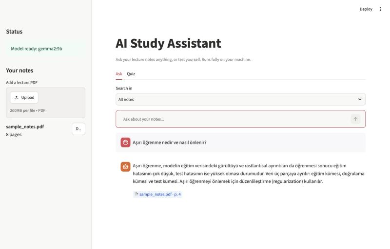
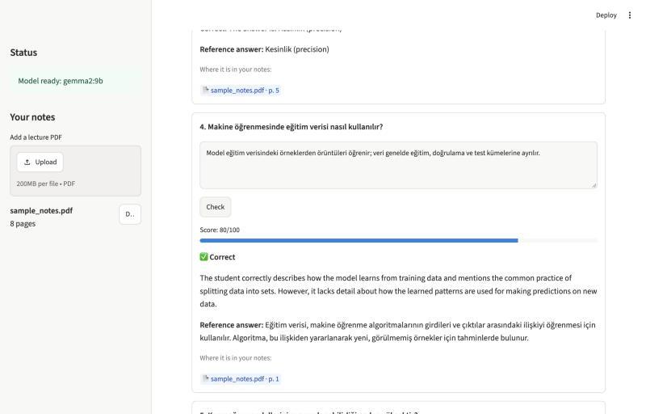
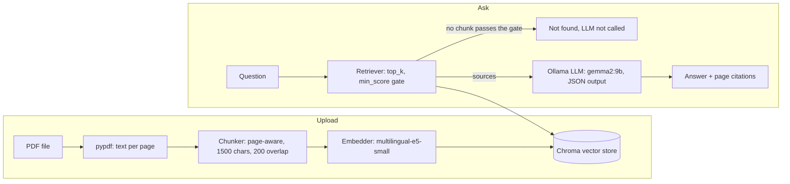

# AI Study Assistant

Upload your lecture PDFs, ask questions in Turkish or English, and get answers with page citations. Then take a quiz that the local model grades for you. Everything runs on your own machine: no API keys, no cloud, no cost per question.

[](https://github.com/AInancKaya/AI-study-Assistant/actions/workflows/ci.yml)




## Features

| | |
| --- | --- |
| **Ask your notes** | Questions in Turkish or English. Each answer lists the file and page it came from. Scope the search to one document or all of them. |
| **Says "not found"** | Questions the notes do not cover get "not found in your notes" with no citations. The model is not asked to guess. |
| **Quizzes** | Generated from your notes: multiple choice (graded deterministically) and open-ended (graded 0-100 with feedback and page references). |
| **Turkish-safe PDF reading** | Keeps ı, İ, ş, ğ, ç, ö, ü and repairs words hyphenated at line ends. Scanned PDFs are rejected with a clear message (no OCR). |
| **Local-first** | Embeddings and the LLM run on your machine through Ollama. Notes and quizzes stay in `data/`. |



## Why it's interesting

- **Grounded, not generated from memory.** Retrieval first, then the model answers only from numbered sources. Citations are checked against the sources it was given; invalid ids are dropped.
- **Zero running cost.** The LLM (Ollama) and the multilingual embedder (`intfloat/multilingual-e5-small`) run locally.
- **Measured, not just demoed.** Retrieval and end-to-end evals run on a committed sample of Turkish and English notes. Results and their limits are in [Evaluation](#evaluation).
- **Layered like a real service.** Pure Python core (ingest, RAG, quiz, grading) behind a FastAPI backend, with a Streamlit client that talks only over HTTP.

## Architecture



The full module map and the `/ask` request sequence are in [docs/architecture.md](docs/architecture.md).

## Quickstart

The commands below use Homebrew (macOS). On other systems, install `uv` and `ollama` your own way. uv installs Python 3.12.

```bash
brew install uv ollama                 # uv: Python and dependencies; ollama: local LLM
ollama serve                           # skip if the Ollama app is already running
ollama pull gemma2:9b                  # ~5.4 GB, once (make setup also pulls it)

git clone https://github.com/AInancKaya/AI-study-Assistant.git
cd AI-study-Assistant
make setup                             # uv sync + ollama pull gemma2:9b
make start                             # checks Ollama and the model, then starts API and UI
```

Open **http://localhost:8501**. The API docs are at http://localhost:8000/docs.

- `make start` runs `scripts/run_local.sh`, which refuses to start with a clear message if Ollama is down or the model is missing.
- `make run` starts the same two servers without those checks.
- Ctrl+C stops both.
- The first run also downloads the embedding model from Hugging Face.

### Docker

```bash
docker compose up --build
```

This starts the API (`:8000`) and the UI (`:8501`) from one image. **Ollama is not in the compose file.** It runs on the host, so start it (`ollama serve`) and pull the model first. The containers reach it at `host.docker.internal:11434`.

### Switching models

| Model | Use it when | Status here |
| --- | --- | --- |
| `gemma2:9b` (default, ~5.4 GB) | Default. Good Turkish. | Used for all numbers in [Evaluation](#evaluation). |
| `qwen3:8b` | Alternative 8B model. | Not evaluated here. |
| `gemma3:4b` | Smaller model for 8 GB machines. | Not evaluated here. |

```bash
MODEL=qwen3:8b make setup                  # pull the model
STUDY_LLM_MODEL=qwen3:8b make start        # run with it
```

`make start` checks the model from the shell environment, so pass `STUDY_LLM_MODEL` on the command line, not only in `.env`.

## Configuration

Every setting is in `src/study_assistant/config.py`. Override any of them with an environment variable named `STUDY_<FIELD>` or in a `.env` file (see `.env.example`). No API keys are needed.

| Setting | Env var | Default | What it controls |
| --- | --- | --- | --- |
| `ollama_host` | `STUDY_OLLAMA_HOST` | `http://localhost:11434` | Ollama server URL |
| `llm_model` | `STUDY_LLM_MODEL` | `gemma2:9b` | Ollama model for answers, quizzes and grading |
| `llm_timeout_s` | `STUDY_LLM_TIMEOUT_S` | `180.0` | Seconds to wait for one LLM call |
| `embedding_model` | `STUDY_EMBEDDING_MODEL` | `intfloat/multilingual-e5-small` | Sentence-embedding model |
| `data_dir` | `STUDY_DATA_DIR` | `data` | Chroma store (`chroma/`) and quiz database (`quizzes.db`) |
| `chunk_size` | `STUDY_CHUNK_SIZE` | `1500` | Chunk length in characters |
| `chunk_overlap` | `STUDY_CHUNK_OVERLAP` | `200` | Characters shared by neighbouring chunks |
| `top_k` | `STUDY_TOP_K` | `6` | Chunks retrieved per question |
| `min_score` | `STUDY_MIN_SCORE` | `0.75` | Cosine-similarity gate; below it the LLM is not called |
| `quiz_max_chunks` | `STUDY_QUIZ_MAX_CHUNKS` | `10` | Chunks sampled across a document for a quiz |
| `max_upload_mb` | `STUDY_MAX_UPLOAD_MB` | `50` | Upload size limit (413 above it) |
| `max_pages` | `STUDY_MAX_PAGES` | `300` | Page limit per PDF (413 above it) |
| `api_url` | `STUDY_API_URL` | `http://localhost:8000` | Where the Streamlit UI finds the API |

## Evaluation

Two evals, both on a committed sample: `evals/data/sample_notes.pdf` (8 pages of Turkish machine-learning notes) with 24 answerable and 4 off-topic questions in Turkish and English. Full per-question tables: [retrieval.md](evals/results/retrieval.md) and [live_eval.md](evals/results/live_eval.md).

**Retrieval** (offline, real embedder, no LLM), 2026-11-24, `multilingual-e5-small`, chunk 1500 / overlap 200, k = 6:

| Metric | Value |
| --- | --- |
| hit@6 (correct page among top 6) | 0.958 (23 of 24) |
| MRR | 0.889 |
| Lowest top-1 score on a correct answer | 0.786 |
| Highest top-1 score on an off-topic question | 0.787 |

**End to end** (answers and judge: `gemma2:9b`, temperature 0), 2026-11-24:

| Metric | Value | Over |
| --- | --- | --- |
| Answered rate | 95.8% (23 of 24) | answerable questions |
| Grounded, judged by the LLM | 91.3% (21 of 23) | answered questions |
| Citation-page accuracy | 100% | answered answerable questions |
| Not-found accuracy | 100% (4 of 4) | off-topic questions |
| Latency of `ask`, average / p95 | 28.7 s / 40.7 s | all questions |

**What these numbers do and do not show**

- **The sample is small**: one 8-page document and 28 questions. Treat the percentages as a smoke test, not a benchmark.
- **The judge is the same local model** that writes the answers, so "grounded" is a self-check, not an independent audit.
- **There is no clean similarity threshold.** The highest off-topic score (0.787) is above the lowest correct score (0.786), so `min_score` cannot separate the two. It is a cheap pre-filter that skips the LLM for clearly unrelated questions. Off-topic questions that pass it are rejected by the model's own `found = false`. Those are the 4/4 above; one of them (a lentil-soup question scoring 0.787) passed the gate and was rejected by the model.
- **Misses**: one retrieval miss (the bias-variance question, no correct page in the top 6, and the live pipeline answered "not found") and two answers the judge marked as not grounded (questions 16 and 17, both on decision trees and random forests).

## Testing

| Command | What runs | Needs |
| --- | --- | --- |
| `make test` | Unit tests (default `pytest` run) | Nothing. No network, Ollama or real embedder. |
| `make lint` | `ruff check` and `ruff format --check` | Nothing |
| `make eval` | Retrieval eval (`-m slow`), writes `evals/results/retrieval.md` | Embedding model download |
| `make live-eval` | End-to-end eval (`-m live`), writes `evals/results/live_eval.md` | Running Ollama with the model |

Tests that load the real embedder are marked `slow`; tests that call Ollama are marked `live`. Both are excluded from the default run.

## Project structure

```
src/study_assistant/
  config.py          Settings (STUDY_ env vars)
  models.py          Shared Pydantic models
  ingest/            pdf.py (text per page), chunking.py (overlapping chunks)
  embeddings.py      Embedder protocol and the e5 implementation
  store.py           Chroma vector store (add, search, list, delete)
  llm.py             LLMClient protocol and Ollama client
  rag.py             ask(): retrieve, gate, generate, check citations
  quiz.py            Quiz generation and validation
  grading.py         Multiple choice (deterministic) and open-ended (LLM) grading
  quiz_store.py      SQLite storage for quizzes
  api/               FastAPI app (main.py) and HTTP-only schemas
ui/                  Streamlit app (app.py) and HTTP client (api_client.py)
evals/               Retrieval and live evals, sample notes, gold questions
scripts/             run_local.sh (make start), make_pdf.py (sample PDF)
docs/learning/       Step-by-step notes (Turkish)
docs/architecture.md Module map and request flow
```

## Roadmap

- React frontend in place of Streamlit
- OCR for scanned PDFs
- More input formats
- An optional cloud LLM backend, off by default, behind the same `LLMClient` interface

## What I learned

I built this project step by step and wrote a note for each step, in Turkish: how PDFs are read, why chunks overlap, what embeddings and a vector store do, how RAG keeps answers grounded, how quizzes are generated and graded, and how to measure whether the system works. The index is in [docs/learning/README.md](docs/learning/README.md).

## License

[MIT](LICENSE)
