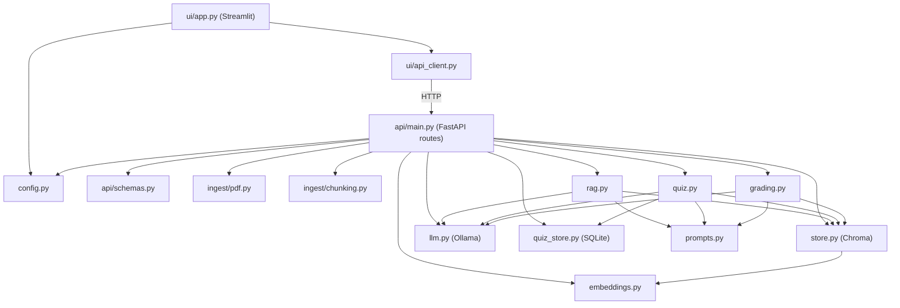
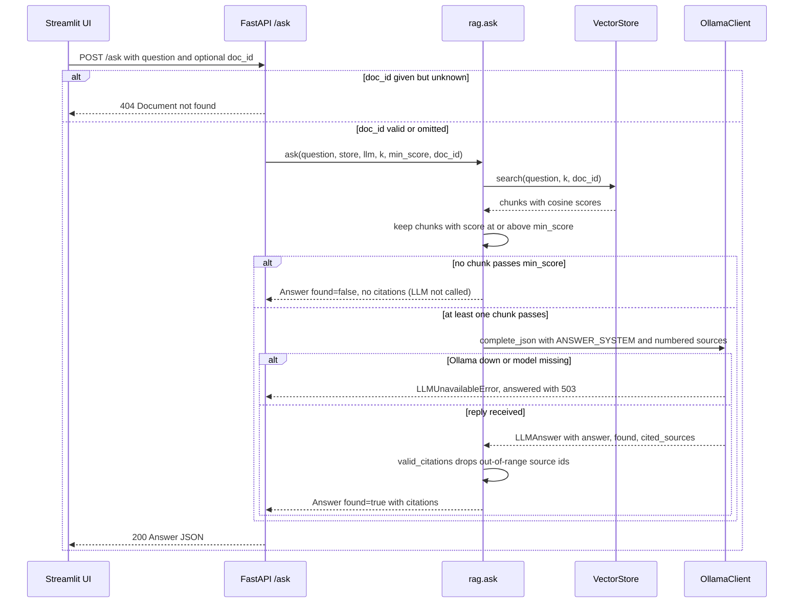

# Architecture

The app is three layers: a pure-Python core (ingest, retrieval, RAG, quizzes, grading), a FastAPI backend that exposes the core over HTTP, and a Streamlit UI that only calls the HTTP API. The core never imports FastAPI or Streamlit.

## Module map

Arrows point from a module to the modules it imports. Every module also imports `models.py` (shared Pydantic types), which is left out for readability.

| Module | Responsibility |
| --- | --- |
| `config.py` | `Settings`: every tunable value, read from `STUDY_*` environment variables or `.env`. |
| `models.py` | Shared Pydantic models: pages, chunks, answers, quizzes, grades, and the stricter schemas the LLM must fill. |
| `ingest/pdf.py` | Reads the text layer of each page, normalises Turkish text, rejects scans and unreadable files, derives a content-hash `doc_id`. |
| `ingest/chunking.py` | Splits pages into overlapping chunks that never cross a page boundary, so every chunk has one page number. |
| `embeddings.py` | `Embedder` protocol and `E5Embedder` (`multilingual-e5-small`, normalised vectors, `passage:` and `query:` prefixes). |
| `store.py` | `VectorStore` on a persistent Chroma collection: add a document, cosine search (optionally per document), list, delete. |
| `llm.py` | `LLMClient` protocol and `OllamaClient`: JSON-schema output, one retry on invalid JSON, typed errors for "Ollama down" and "model missing". |
| `prompts.py` | System prompts for answers, quizzes and grading, and the numbered source block sent to the model. |
| `rag.py` | `ask()`: retrieve, drop hits below `min_score`, skip the LLM if none remain, ask the model, keep only valid citations. |
| `quiz.py` | `generate_quiz()`: sample chunks across a document, fit them into the context budget, validate every generated question, save the quiz. |
| `quiz_store.py` | `QuizRepository`: one SQLite row per quiz, holding the full JSON including the answer key. |
| `grading.py` | Multiple choice is compared with the stored answer (no LLM). Open-ended answers go to the LLM; the verdict is computed in code from the score. |
| `api/main.py` | `create_app()` factory and the routes (`/health`, `/documents`, `/ask`, `/quiz`, `/grade`). Maps errors to HTTP status codes. |
| `api/schemas.py` | Request bodies that exist only at the HTTP layer. |
| `ui/api_client.py` | `ApiClient`: one method per endpoint, raises `ApiError` with the server's message. |
| `ui/app.py` | Streamlit page: sidebar (status, upload, documents), Ask tab, Quiz tab. |

## `/ask` request sequence

Errors from the LLM layer are mapped in `create_app`: `LLMUnavailableError` and `ModelNotFoundError` become 503 (with the fix command in the message), other `LLMError`s become 502. A question that is empty or whitespace-only is rejected with 400 inside `rag.ask`.

## Design decisions

- **Protocols at the edges.** `Embedder` and `LLMClient` are small protocols, so unit tests use fakes (`tests/fakes.py`) and never load the real embedder or call Ollama.
- **The gate runs before the model.** `min_score` filters retrieved chunks in code. Questions with no sufficiently similar chunk never reach the LLM. This is a cheap pre-filter, not a perfect separator (see the README evaluation section).
- **The model proposes, code validates.** Citations, quiz options, answer-key indexes and grades are checked in Python after the LLM replies. Invalid items are dropped; the API does not return a 500 for bad model output.
- **Answer keys stay server-side.** `Quiz.public()` strips `correct_option` and `reference_answer` before the quiz leaves the API.
